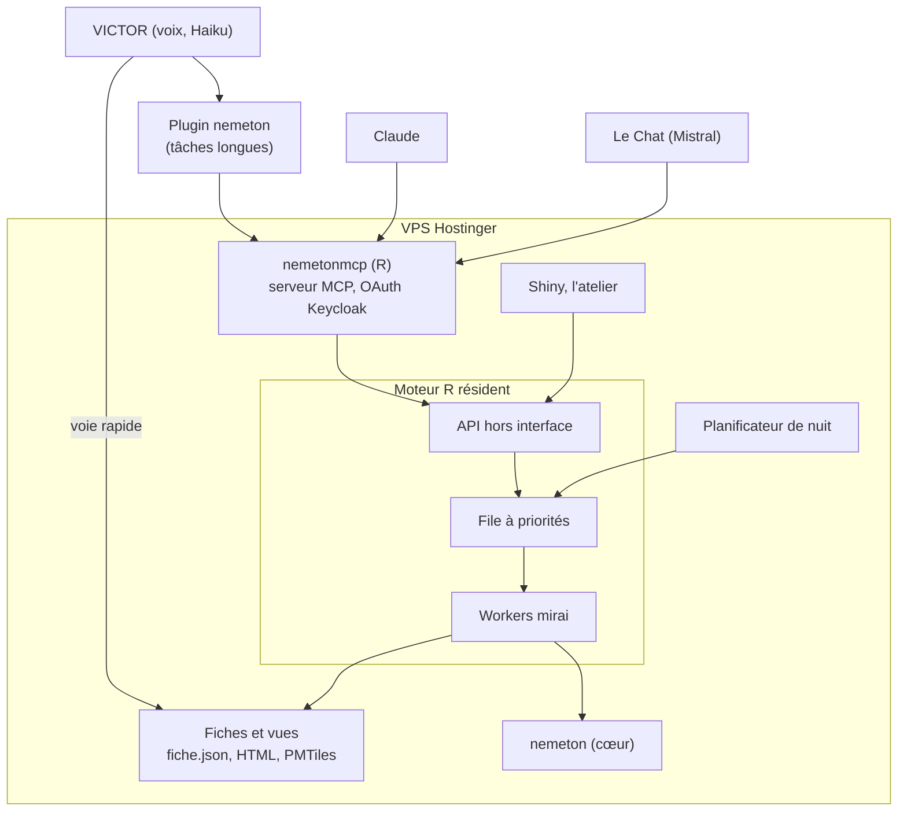
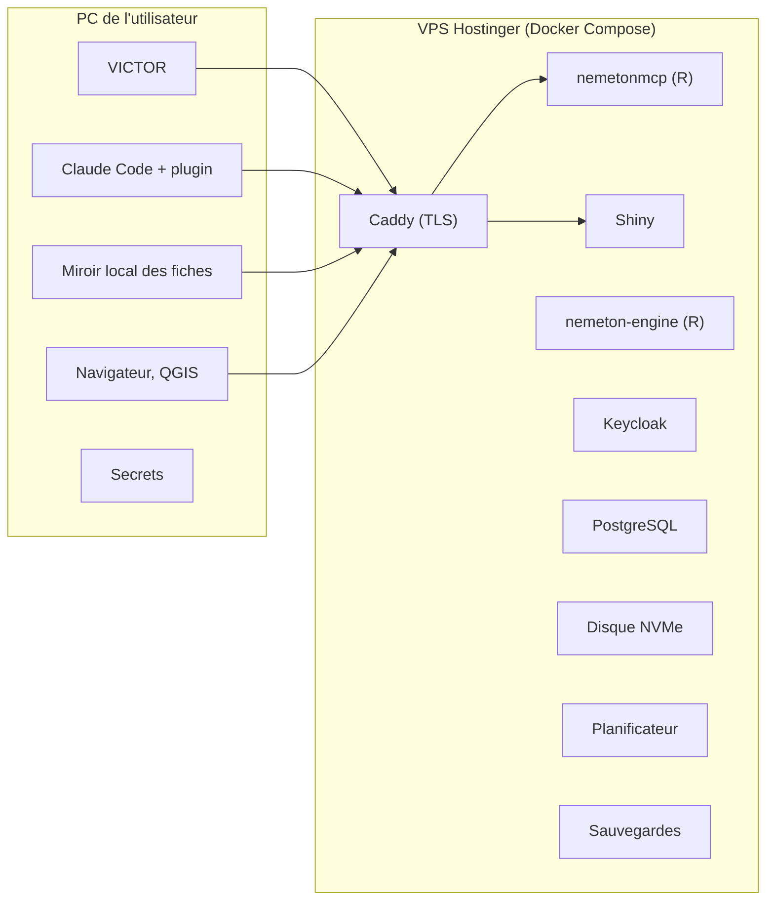

# Nemeton × LLM : Claude ou Mistral comme interface

État au 24 octobre 2026 · Pascal Obstétar. Document de référence vivant :
<https://claude.ai/artifact/PCiCwpRWYVKzLdWuNUkRLq>. Cette copie fige les
décisions prises ; en cas d'écart, le document en ligne fait foi.

## Synthèse

**Tout reste en R. Le serveur MCP existe déjà : c'est `nemetonclaude`, renommé
`nemetonmcp` (même nom pour le dépôt GitHub et le paquet R). Il est servi sur
un VPS Hostinger en France avec OAuth Keycloak, partagé par plusieurs
utilisateurs, et branché d'abord sur VICTOR (voie rapide + plugin `nemeton`),
puis sur Claude et Mistral.** Shiny reste en service comme atelier
cartographique.

- **L'existant est déjà avancé.** nemetonshiny a une API hors interface
  exportée et un serveur MCP de 10 outils ; nemetonmcp l'étend (vues, serveur
  distant OAuth Keycloak, plugin Claude Code) ; VICTOR suit les calculs.
- **La couche d'entrée est celle de l'app, pas le cœur** : elle porte l'état
  projet, les verrous, le plafond mémoire et les calculs détachés.
- **Pour VICTOR, la vitesse vient du chemin plus que du cache** : les
  questions de lecture lisent une fiche pré-calculée sans passer par
  `claude -p` ni par R. Le plugin ne sert qu'aux tâches longues.
- **Calculs de fond** : file à priorités, workers chauds, recalcul
  incrémental, pré-calcul de nuit ; montée en charge seulement ensuite.
- **Une seule fiche JSON** alimente `display_report` (VICTOR), les vues
  (Claude) et le texte (Le Chat).
- **Hébergement** : le PC ne garde que VICTOR, Claude Code et son plugin, un
  miroir des fiches et les secrets ; base, caches, calculs et Shiny vont sur
  le VPS, avec des droits par projet.

## Existant

### nemetonshiny (v2026.10.18)

App golem de 95 fichiers R (≈ 84 000 lignes), sans logique métier : tout
calcul passe par `nemeton`.

| Brique | Fichier(s) | État |
| --- | --- | --- |
| API hors interface | `R/api.R` : `projets_lister`, `projet_etat`, `projet_lire`, `parcelles_commune`, `projet_creer`, `projet_calculer`, `projet_rapport`, `projet_gpkg` | exportée, lecture sans effet de bord, erreurs classées |
| Serveur MCP | `R/service_mcp.R` + `inst/mcp/server.R` (mcptools, stdio) | 10 outils : lister, résumer, lancer / suivre / annuler un calcul, rapport PDF, GeoPackage, UGF, croisement ONF, lien vers l'app |
| Calcul détaché | `Rscript` en `setsid`, `data/compute_job.json` + journal | survit à la fin de la tâche de l'assistant |
| Lien profond | `url_app` → `?project=…&tab=…` | ouvre l'app sur le bon onglet |
| LLM intégré | `R/llm_prompts.R`, `service_llm*.R`, `service_rag.R` (ellmer) | Mistral, Anthropic, OpenAI ; 20 profils experts YAML ; RAG |
| Auth, déploiement | `mod_auth.R`, `keycloak/`, `docker-compose.yml` | Keycloak OIDC, Docker |
| Stockage projet | `data/parcels.gpkg`, `data/indicators.parquet`, `tenements.gpkg`, `ugs.json` | Parquet en place |

### nemetonmcp (ex-nemetonclaude, v0.7.2)

- `r/` : paquet R qui étend le serveur MCP de nemetonshiny (création de
  projet, `vue_atlas`, `contexte_carto`, `detail_indicateur`, plan d'actions,
  `profils_experts`, `exporter_marculus`) ; le sert en stdio ou en HTTP
  distant (Streamable HTTP, OAuth 2.1 Keycloak, métadonnées RFC 9728, outils
  en lecture ou en écriture selon le rôle, liens de téléchargement signés).
- `vues/` : moteur commun (`nemeton-view.js`, `.css`) et quatre vues publiées
  en artefacts Claude : Sélection, Atlas, Calcul, Plan d'actions.
- Plugin Claude Code `nemeton` (marketplace du dépôt) et skill `nemeton-vues`.
- `deploiement/` : Caddy, service systemd, client Keycloak.

### nemeton (cœur)

302 fonctions exportées : 41 indicateurs, 12 familles, NDP, santé (FAST,
FORDEAD, RECONFORT), IFN, régénération, LiDAR, RAG. **Il n'est jamais exposé
directement à un LLM** : l'état projet vit dans l'app, les calculs sont longs,
et 302 fonctions feraient trop d'outils. Les outils suivent les tâches du
forestier, pas les fonctions R.

## Correspondance Shiny → LLM

Trois modes : **Conversation** (outil MCP + texte), **Vue** (vue interactive),
**Atelier** (lien profond vers Shiny).

| Onglet Shiny | Mode cible | Outils MCP | Déjà là ? |
| --- | --- | --- | --- |
| Synthèse (score, NDP, radar) | Conversation + Vue | `resume_projet`, `vue_atlas` | oui |
| Perspective IA par profil | Conversation | prompts issus des 20 profils experts | partiel (`profils_experts`) |
| Familles (12 vues) | Conversation + Vue | `vue_atlas`, `detail_indicateur` | oui |
| Calcul, rapport, export | Conversation + Vue Calcul | `lancer_calcul`, `etat_calcul`, `generer_rapport`, `exporter_gpkg` | oui |
| Sélection commune / parcelles | Vue Sélection | `chercher_commune`, `parcelles_commune`, `creer_projet` | oui |
| UGF | Conversation puis Atelier | `appliquer_ugf`, `croiser_onf` | oui |
| Plan d'action | Vue Plan | `plan_actions`, `ajouter_action`, `modifier_action` | oui |
| Suivi sanitaire | Conversation (alertes), Atelier (cartes pixel) | `alertes_sanitaires` | non |
| Régénération | Conversation | `regen_essences` | non |
| Terrain (échantillonnage, import, vidéo, desserte) | Atelier | `url_app` | lien oui |
| Connaissances (RAG) | Conversation | `chercher_connaissances` | non |

## Architecture

**Choix du langage : R.** La couche MCP coûte quelques millisecondes dans tout
langage ; les calculs restent en R. Le point faible de R est la concurrence
(un processus = une requête), traité par les fiches statiques servies par
Caddy, la file de calcul et plusieurs processus derrière Caddy (sessions
collantes). Une façade TypeScript (SDK MCP officiel + `@modelcontextprotocol/ext-apps`)
ne se justifierait que pour les MCP Apps, pour des fonctions MCP absentes de
`mcptools` (prompts, ressources), ou sur une saturation mesurée. La logique de
Nemeton ne quitte pas R.

**Mesurer avant d'optimiser** : une ligne de journal par appel d'outil (nom,
durée, utilisateur), puis un essai à deux ou trois utilisateurs simultanés sur
l'Atlas.

## Déploiement sur VPS Hostinger

Tout le serveur tourne sur un VPS Hostinger en France ; le PC ne garde que ce
qui touche la voix, l'écran et les secrets. Remplace l'ADR-003
(OVHcloud + Scaleway).

**Sur le PC**

| Élément | Rôle | Pourquoi local |
| --- | --- | --- |
| VICTOR (`server.py`) | voix, `display_report`, ouverture d'apps | micro, écran, bureau |
| Claude Code + plugin `nemeton` | tâches longues ; config MCP vers `https://…/mcp` | abonnement Claude de l'utilisateur |
| Miroir local des fiches et vues | copie tenue à jour par ETag, limitée aux projets autorisés | réponse instantanée, lecture hors ligne |
| Navigateur, QGIS, QField | atelier Shiny distant, terrain | outils de bureau |
| Secrets | jeton Keycloak, clés Anthropic et Gradium (`.env`) | ne quittent jamais le PC |

**Sur le VPS** (un `docker-compose.yml` dans `deploiement/`)

| Service | Contenu |
| --- | --- |
| Caddy | TLS Let's Encrypt, seul point d'entrée ; fiches, vues et PMTiles en statique après contrôle d'accès ; répartition entre processus R |
| Keycloak | comptes, groupes (agence ONF, coopérative, CRPF), jetons OAuth — mode production |
| nemetonmcp (R) | serveur MCP distant : HTTP, OAuth, rôles, liens signés ; droits par projet et SSE à ajouter |
| nemeton-engine (R) | API hors interface de nemetonshiny, file de calcul, workers `mirai`, cache `cachem` ; interne |
| Shiny | atelier cartographique, derrière Caddy et Keycloak ; 2-3 répliques si besoin |
| PostgreSQL | PostGIS, TimescaleDB, pgvector, métadonnées, `project_members`, verrous, tâches, audit ; pool de connexions ; pas de rasters (ADR-002) |
| Disque NVMe | projets (`/data/projects/<id>`), caches globaux, couches LiDAR et Sentinel-2 par commune en COG, fiches, vues, PMTiles |
| Planificateur | conteneur cron : recalculs de nuit, scènes Sentinel-2, fiches, `pg_dump` |
| Sauvegardes | hebdomadaire Hostinger + copie quotidienne hors du VPS |

**Dimensionnement.** Offres VPS France : KVM 1 (1 vCPU, 4 Go, 50 Go NVMe) à
KVM 8 (8 vCPU, 32 Go, 400 Go NVMe), payées d'avance au mois
([Hostinger](https://www.hostinger.com/vps/servers/france), consulté le
24/10/2026). KVM 8 pressenti : environ 2 vCPU et 6 Go pour les services, le
reste pour les workers. À valider par la mesure d'un calcul complet.

**Conséquences**

- Authentification obligatoire partout : nemetonmcp (OAuth) est le point
  d'entrée unique, VICTOR compris.
- VICTOR ne lit plus les fichiers projet (`compute_job.json`) : flux SSE et
  miroir des fiches.
- `open_nemeton` ouvre l'URL HTTPS du serveur au lieu de démarrer Shiny en local.
- Pas de montée en charge à l'heure sur les VPS : second VPS de workers
  (`mirai` par SSH) ou instances GPU Hostinger à l'heure, détruites quand les
  crédits sont épuisés, donc réservées aux tâches sans état
  ([Hostinger, instances GPU](https://www.hostinger.com/support/how-to-set-up-a-gpu-instance-at-hostinger/)).
- Disque : garder les COG dérivés, supprimer les LAZ bruts après traitement,
  surveiller l'occupation.

## Plusieurs utilisateurs

Existe déjà : rôles globaux Keycloak, `owner_id` dans `projects`, verrou
d'édition (`project_lock_*`), garde anti-doublon de calcul ; dans nemetonmcp,
isolation `collectif` ou `utilisateur`. Il manque les droits **par projet**.

| Rôle sur le projet | Peut | Exemple |
| --- | --- | --- |
| Lecteur | consulter fiches, vues, rapports ; interroger VICTOR ou Claude | propriétaire, élu |
| Éditeur | en plus : lancer un calcul, modifier UGF et plan d'action | gestionnaire, technicien |
| Propriétaire | en plus : partager, supprimer | créateur du projet |

Table `project_members` (projet, utilisateur ou groupe Keycloak, rôle).
Contrôle à chaque porte : serveur MCP (chaque outil ; `lister_projets` filtré ;
projet non autorisé = « introuvable »), Caddy (`forward_auth` ou URL signées),
SSE, miroir VICTOR, journal d'audit.

| Situation | Mécanisme | Déjà là ? |
| --- | --- | --- |
| Plusieurs lecteurs | une fiche et un cache par projet, partagés | à faire |
| Deux éditeurs | verrou d'édition, le second passe en lecture | oui |
| Deux demandes de calcul | une seule tâche ; la seconde s'y abonne | garde oui, abonnement à faire |
| Fin de calcul | annonce à tous les membres connectés | à faire (SSE) |

Projets différents en parallèle : file équitable (interactif avant nuit,
plafond de tâches par utilisateur), caches par commune partagés, projets dans
un dossier serveur commun. Limite de R : lectures courantes en statique,
travail long en file, répliques du moteur et de Shiny, pool PostgreSQL.

**Confidentialité** : interroger un projet depuis Claude.ai ou Le Chat envoie
la fiche au fournisseur du LLM. Option par projet « pas d'accès par LLM
externe ».

## Réactivité entre VICTOR et l'utilisateur

Aujourd'hui, « Victor, où en est Dabo ? » enchaîne : transcription, choix de
Haiku, démarrage de `claude -p`, démarrage du serveur MCP stdio (R +
nemetonshiny), appel d'outil, affichage. Les démarrages à froid coûtent le
plus (non mesurés).

| Proposition | Effet | Où |
| --- | --- | --- |
| **Voie rapide** : outils de lecture directs dans VICTOR (`nemeton_fiche`, `nemeton_etat`) | ni Claude Code ni R pour les questions courantes | victor + nemetonmcp |
| **Moteur R résident** sur le VPS | plus de démarrage de R par tâche | nemetonshiny + nemetonmcp |
| **Une seule fiche JSON** | alimente `display_report`, les vues et le texte | nemetonmcp |
| **Accusé vocal immédiat** | une réponse en moins d'une seconde | victor |
| **Annonces d'avancement** (« 10 familles prêtes ») | relayées par `surveiller_calculs` | nemetonshiny + victor |
| **Vues relues au serveur** | toujours à jour sans republication (déjà amorcé dans l'Atlas) | nemetonmcp |
| **Pré-chargement** de la fiche d'un projet nommé | la question suivante répond sans outil | victor |
| **Point du matin** | résultats de la nuit annoncés | victor |
| **Mesure** des durées par étape | savoir où part le temps | victor |

## Calculs en tâche de fond

Existe : calcul détaché, plafonné en mémoire, pool `future` borné, reprise
après arrêt, caches globaux du cœur (OSO, E-OBS, NASA POWER, TWI, chasse,
modèles RECONFORT).

| Proposition | Effet | Effort |
| --- | --- | --- |
| File d'attente à priorités | l'interactif passe devant la routine | moyen |
| Workers R chauds (`mirai`) | plus de démarrage de `Rscript` par calcul | moyen |
| Recalcul incrémental par empreinte d'entrées | seuls les indicateurs touchés repartent | moyen |
| Couches lourdes par commune (LiDAR, Sentinel-2) en COG | le LiDAR d'une commune n'est payé qu'une fois | moyen, en partie dans nemeton |
| Ordre « rapide d'abord » | synthèse partielle en quelques minutes | faible |
| Planificateur de nuit | tout est prêt le matin | faible |
| Montée en charge ponctuelle | campagnes lourdes sans bloquer le serveur | élevé, après la file et l'incrémental |

## Affichage rapide

Principe : préparer l'affichage à la fin du calcul, pas au moment de la
question. Une réponse d'outil n'attend jamais un calcul : elle lit une fiche,
ou elle dépose une tâche et rend la main.

| Levier | Techno | Effet |
| --- | --- | --- |
| Fiches pré-calculées | `fiche.json` par projet, en fin de calcul et à chaque jalon | réponses en millisecondes |
| Réponses d'outils | `cachem`, clé = projet + date de `indicators.parquet` + version nemeton | pas de relecture du Parquet |
| Sorties structurées | `structuredContent` (mcptools ≥ 1.0.0) + texte court | moins de jetons |
| Cartes | GeoJSON aujourd'hui ; PMTiles et COG pour les grosses couches | carte fluide |
| Multi-projets | DuckDB sur les Parquet | comparaisons sans boucle R |
| Contexte LLM | descriptions d'outils et prompts stables (prompt caching) | latence et coût réduits |

**PMTiles plus tard.** L'Atlas Couchey pèse environ 0,5 Mo (`atlas.geojson`
210 Ko, `contexte.geojson` 293 Ko) : GeoJSON suffit. PMTiles demanderait de
réécrire la carte (MapLibre), garderait de toute façon les attributs à part,
et suppose des requêtes HTTP partielles que seul Caddy garantit. Règle dès
maintenant : géométrie et attributs séparés, reliés par `ug_id`. Seuil de
bascule : géométrie au-delà de quelques Mo ou chargement de carte au-delà
d'une seconde.

## Dépôts

| Dépôt | Ce qu'il reçoit |
| --- | --- |
| `nemetonmcp` | `r/` serveur MCP commun à tous les LLM, fiche, droits par projet, journal des durées ; `clients/claude/` vues, plugin, skill ; `clients/mistral/` plus tard ; `deploiement/` compose Docker du VPS |
| `nemetonshiny` | moteur : API hors interface, file de calcul, image Docker sur GHCR |
| `victor` | voie rapide, client SSE, miroir local |
| `nemeton` | caches de couches par commune (instance cœur, règle 12) |
| `platform_nemeton` | ADR « VPS Hostinger » et ADR « serveur MCP en R » |

**Renommage** (PR 0.8.0, avant tout autre travail) : `Package:` et appels
`nemetonclaude::` → `nemetonmcp` (y compris `.mcp.json`, config MCP locale,
service) ; variables `NEMETON_CLAUDE_*` → `NEMETON_MCP_*` avec repli
temporaire ; audience Keycloak `nemeton-claude` conservée ; **nom du serveur
MCP `nemeton` inchangé** (les artefacts appellent `host:nemeton`) ;
marketplace renommée, plugin réinstallé.

## Feuille de route

1. **Fait** : API hors interface et MCP stdio dans nemetonshiny ; nemetonclaude
   0.7.x (vues, serveur distant OAuth, plugin) ; suivi des calculs par VICTOR.
2. **Renommage** en `nemetonmcp` (0.8.0), arborescence `r/`, `clients/claude/`,
   `deploiement/`. Retrouver où tourne le connecteur distant (502).
3. **Fiche et voie rapide** : outil `fiche_projet` tiré de l'en-tête de
   l'Atlas, avec un bloc `display_report` ; `nemeton_fiche` et accusé vocal
   dans VICTOR ; journal des durées.
4. **Mise en service du VPS** : compose de production, migration des projets,
   droits par projet, contrôle d'accès aux fichiers statiques, sauvegardes,
   ADR.
5. **Calculs de fond** : file à priorités, workers `mirai`, « rapide
   d'abord », planificateur de nuit, point du matin, SSE.
6. **Recalcul incrémental et couches par commune** ; rétention du disque.
7. **Le Chat et montée en charge** : connecteur Le Chat, prompts experts ;
   répliques, second VPS ou GPU si les mesures le justifient ; façade
   TypeScript seulement si les MCP Apps deviennent nécessaires ; Shiny
   recentré sur l'atelier.

Rien de tout cela ne modifie le dépôt `nemeton`, sauf les caches par commune,
à faire depuis une instance dédiée au cœur.

## Questions ouvertes

- [ ] KVM 8 suffisant pour le LiDAR et les caches de toutes les communes suivies ?
- [ ] Destination de la sauvegarde externe ?
- [ ] Nom de domaine pour Caddy, Keycloak et le serveur MCP ?
- [ ] Partage par personne, par groupe, ou les deux ? Combien d'utilisateurs simultanés au plus ?
- [ ] Shiny retiré à terme, ou atelier conservé (recommandé) ?
- [ ] Le Chat reste-t-il une cible, sachant qu'aucune source ne confirme son affichage des MCP Apps ?
- [ ] Où tourne le connecteur distant qui répond 502 (le `Caddyfile` garde l'exemple `nemeton.example.org`) ?
