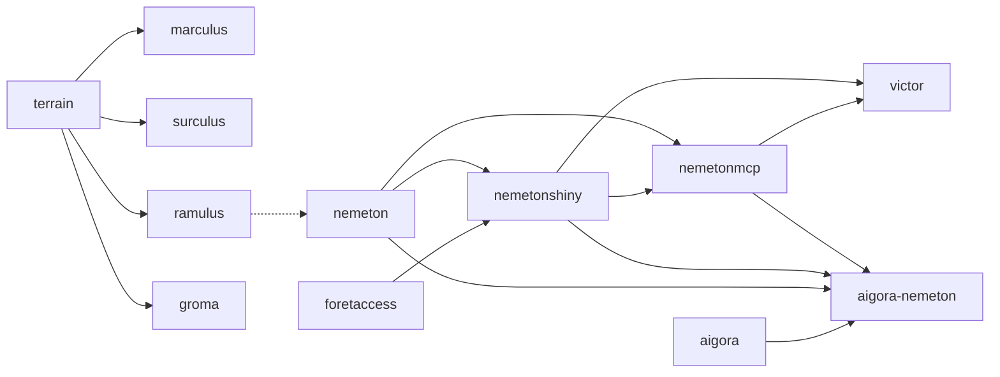

# Carte des dépendances de la plateforme Néméton

> **Statut : validée par Pascal le 2026-11-16, avec le brief.** Relevé du 2026-11-16, fait par lecture
> de la branche `main` de chaque dépôt. Les liens sont dans `docs/carte.yaml` (source unique), chacun avec le fichier où il est
> écrit ; un lien non vérifié y porte `confirme: non`.

## Les projets et leur état

| Projet | Nature | Méthode de l'Impératrice |
|---|---|---|
| `nemeton` | paquet R, cœur métier | plugin activé (`.claude/settings.json`), pas de `pilotage/` |
| `foretaccess` | paquet R | ni plugin ni `pilotage/` |
| `nemetonshiny` | application Shiny/golem | `pilotage/` complet, équipe validée le 2026-11-10 ; pas de `.claude/settings.json` versionné |
| `nemetonmcp` | paquet R (`r/`) et plugin Claude | ni plugin ni `pilotage/` |
| `victor` | assistant vocal, Python | ni plugin ni `pilotage/` |
| `aigora` | Claude Code en local, RStudio | non ; a ses propres agents, hooks et règles (`.claude/`) |
| `aigora-nemeton` | adaptation privée d'`aigora` : diagnostics Néméton pour des clients, sans interface | non ; a ses propres agents, hooks et règles (`.claude/`), pas de `.claude/test-command` |
| `terrain` | bibliothèque Kotlin (modules carte, gnss, gpkg, journal, style, voix), publiée par JitPack | plugin activé, `pilotage/` |
| `marculus` | application Android, martelage forestier | plugin activé, `pilotage/` |
| `surculus` | application Android, suivi des travaux de plantation | plugin activé, `pilotage/` |
| `ramulus` | application Android, état des houppiers (protocole DEPERIS du DSF) | plugin activé, `pilotage/` |
| `groma` | inventaire forestier par vidéo : application Android, paquet Python, serveur | plugin activé, `pilotage/` |
| `sylvostation` | paquet R et pipeline `targets` : catalogue de stations forestières par sylvoécorégion | `CLAUDE.md` de la méthode et `pilotage/` ; délégation totale de Pascal depuis le 2026-11-16 (son `CLAUDE.md`) |

L'état lu de chaque projet (dernier tag, commit lu sur la branche par défaut) est dans
`pilotage/etat-cycle.yaml`, réécrit à chaque cycle.

`sylvostation` n'a pas de clone dans `~/dev`. Sa branche par défaut sur GitHub est
`claude/admiring-cerf-hq7t8l` : il n'a pas de `main`. Son `DESCRIPTION` n'importe aucun
projet de la plateforme, et aucun lien n'est relevé.

Les six dernières lignes ont été ajoutées le 2026-11-16 à la demande de Pascal, d'après une
première lecture du dépôt local de chaque projet ; l'état de confirmation
de leurs liens est dans `docs/carte.yaml` (champ `confirme`).

`aigora-nemeton` a été ajouté le 2026-11-16 à la demande de Pascal. C'est un dépôt git
local, `~/dev/aigora/aigora-nemeton`, dont l'`origin` est le clone local d'`aigora`
(`~/dev/aigora/aigora`) : il n'a **pas de dépôt GitHub**, et son `README.md` dit « ne
jamais publier ce dossier ». Sa branche `main` a 13 commits d'avance et 4 de retard sur
cet `origin`. Son `CLAUDE.md` lui interdit de modifier les dépôts Néméton : il leur écrit
des briefs dans `~/dev/briefs/vers-<dépôt>/`. Les données des clients (`missions/`)
restent sur le PC de Pascal.

## Qui dépend de qui

La flèche va de l'amont vers l'aval : un changement en amont peut casser l'aval.

Les liens (18 au 2026-11-17 : amont, aval, nature, ce par quoi ils passent, source et
état « confirmé ou non ») sont dans **`docs/carte.yaml`**, source unique, lue par
l'orchestrateur à chaque cycle (`docs/spec.md` § 8). Ils ne sont plus recopiés ici.
Quatre liens y portent encore `confirme: non`, chacun avec la question posée à Pascal
(mission 010, 2026-11-17) ; les deux autres des six liens « à confirmer » ont été retirés
(`surculus` ← `nemetonshiny` et `nemeton` ← `surculus` : `surculus` ne lit que la tournée de
sommieR, qui n'est pas un projet de la carte ; preuves en pied de `docs/carte.yaml`).
Le schéma ci-dessus n'en dessine que quinze (le lien pointillé est le seul `non` dessiné) ;
ne sont pas dessinés : `groma` ← `nemeton` et `groma` ← `nemetonshiny` (briefs, `non`),
`aigora-nemeton` ← `victor` (`non`). En cas d'écart, le YAML fait foi.

Lien non trouvé : `nemeton` ne déclare pas `foretaccess` dans son `DESCRIPTION`, alors
que `nemeton/specs/` contient des briefs `brief-foretaccess-*.md`. Les deux projets
s'écrivent sans dépendre l'un de l'autre par le code.

## Ce que la carte impose

**En série**, dans cet ordre, quand un changement descend la chaîne :

0. `terrain`, jusqu'à la release, avant `marculus`, `surculus`, `ramulus` et `groma` ;
1. `nemeton` ou `foretaccess`, jusqu'à la release (l'aval installe la dernière release,
   pas `main`) ;
2. `nemetonshiny`, jusqu'à la release ;
3. `nemetonmcp`, dont le test `test-contrat_nemetonmcp.R` de nemetonshiny verrouille le
   contrat ;
4. `victor` et `aigora-nemeton`, qui consomment tous deux `nemetonmcp`.

`aigora` n'est en aval d'aucun projet Néméton : il ne nomme pas Néméton ; seule son
adaptation `aigora-nemeton` le fait (`CONTRAT.md` de nemetonshiny, § 6 bis, parle du
« serveur MCP de VICTOR et d'AIGORA »).

**En parallèle** :

- `nemeton` et `foretaccess`, qui ne dépendent pas l'un de l'autre par le code ;
- `marculus`, `surculus`, `ramulus` et `groma` entre eux, une fois la release de `terrain`
  dont ils dépendent publiée ;
- les tests d'un projet en aval, écrits pendant que l'amont se développe ;
- toute mission qui ne touche ni contrat public ni version minimale d'un autre projet.

## Les passages de relais déjà en place

- `nemeton/specs/brief-nemetonshiny-*.md` et `brief-foretaccess-*.md` : le cœur écrit à
  l'application et à foretaccess.
- `nemetonshiny/briefs/traites/` : les briefs reçus et traités ;
  `nemetonshiny/briefs/vers-platform_nemeton/` : ceux adressés à ce dépôt.
- `~/dev/briefs/vers-<dépôt>/` et `~/dev/briefs/traites/` : les briefs écrits par
  `aigora-nemeton` aux dépôts Néméton (hors de tout dépôt git, à vérifier).
- `nemetonshiny/CONTRAT.md` : ce que l'application garde stable, dont l'API lue par
  `nemetonmcp`.

## Ce qui ne marche pas encore d'un dépôt à l'autre

Lu dans le plugin `imperatrice` 0.7.0. À trancher par ADR avant la première mission
confiée depuis ce dépôt dans un autre.

| Constat | Source | Conséquence |
|---|---|---|
| Le hook `tests_obligatoires` cherche `.claude/test-command` à la racine du dépôt de la session (`CLAUDE_PROJECT_DIR`) ; sans ce fichier, il ne fait rien | `hooks/tests_obligatoires.py` | une session ouverte ici laisse un agent dire « terminé » dans un autre dépôt sans tests verts |
| `/boucle` lance les agents avec `isolation: "worktree"`, soit un worktree du dépôt de la session | `skills/boucle/SKILL.md` | l'agent n'est pas isolé dans le dépôt où il écrit |
| Le plafond humain est écrit par projet (3 PR ouvertes dans `nemetonshiny`) | `nemetonshiny/pilotage/equipe.md` | sans plafond global, les PR à relire s'additionnent d'un projet à l'autre |
| Non vérifié : ce que protègent `garde_main` et `journal_ajout_seul` quand la commande vise un autre dépôt | à lire dans `hooks/` | à vérifier avant de s'y fier |

## Ce qui reste à dire par Pascal

- La liste des projets est-elle complète ? Dépôts au nom voisin non relevés ici :
  `opencanopy`, `maestronemeton`, `treesatnemeton`, `flairhubnemeton`,
  `alphaearthnemeton`, `forptnemeton`, `tarif-nemeton` (hors périmètre, retenu par Pascal
  le 2026-11-16).
- ~~Le lien d'`aigora` avec la plateforme~~ : tranché par Pascal le 2026-11-16, il passe
  par `aigora-nemeton`, ajouté aux projets pilotés.
- `aigora-nemeton` n'a pas de dépôt GitHub et ne doit pas être publié : une PR n'y est
  pas possible comme ailleurs. Comment une mission y passe-t-elle la porte n° 3 ?
- ~~Le nom de ce dépôt~~ : tranché par Pascal le 2026-11-16, **`nemetonplateforme`**.
  Anciens noms : `nemetonplateform` (GitHub, redirigé), `nemeton_plateforme` (README),
  `platform_nemeton` (`CLAUDE.md` de `nemeton` et `nemetonshiny`, dossier
  `nemetonshiny/briefs/vers-platform_nemeton/`) : un brief à déposer dans ces deux projets.
