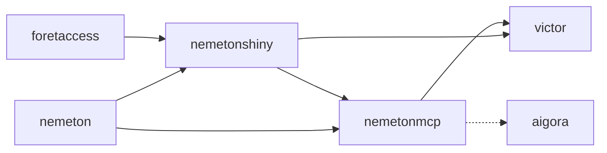

# Carte des dépendances de la plateforme Néméton

> **Statut : proposée, non validée par Pascal.** Relevé du 2026-11-16, fait par lecture
> de la branche `main` de chaque dépôt. Chaque lien cite le fichier où il est écrit. Un
> lien sans source est marqué « à confirmer ».

## Les projets et leur état

| Projet | Nature | Version lue sur `main` | Dernier tag | Méthode de l'Impératrice |
|---|---|---|---|---|
| `nemeton` | paquet R, cœur métier | 2026.11.34.9000 | v2026.11.35 | plugin activé (`.claude/settings.json`), pas de `pilotage/` |
| `foretaccess` | paquet R | 2.6.0.9000 | v2.6.0 | ni plugin ni `pilotage/` |
| `nemetonshiny` | application Shiny/golem | 2026.11.2.9001 | v2026.11.2 | `pilotage/` complet, équipe validée le 2026-11-10 ; pas de `.claude/settings.json` versionné |
| `nemetonmcp` | paquet R (`r/`) et plugin Claude | 2026.11.10 | v2026.11.10 | ni plugin ni `pilotage/` |
| `victor` | assistant vocal, Python | 1.0.0 | aucun | ni plugin ni `pilotage/` |
| `aigora` | Claude Code en local, RStudio | 1.0.0-rstudio | aucun | non ; a ses propres agents, hooks et règles (`.claude/`) |

À regarder : dans `nemeton`, `DESCRIPTION` annonce 2026.11.34.9000 alors que le dernier
tag est v2026.11.35.

## Qui dépend de qui

La flèche va de l'amont vers l'aval : un changement en amont peut casser l'aval.

| Aval | Amont | Par quoi | Source |
|---|---|---|---|
| `nemetonshiny` | `nemeton` | `Imports: nemeton (>= 2026.11.30)`, installé depuis la dernière release | `nemetonshiny/DESCRIPTION` |
| `nemetonshiny` | `foretaccess` | `Imports: foretaccess (>= 2.4.0)`, installé depuis la dernière release | `nemetonshiny/DESCRIPTION` |
| `nemetonmcp` | `nemetonshiny` | `Imports: nemetonshiny (>= 2026.11.2)` ; étend son serveur MCP et lit 33 de ses objets internes | `nemetonmcp/r/DESCRIPTION`, `nemetonshiny/CONTRAT.md` § 6 bis |
| `nemetonmcp` | `nemeton` | `Imports: nemeton (>= 2026.11.30)` | `nemetonmcp/r/DESCRIPTION` |
| `victor` | `nemetonmcp` | appelle `nemetonmcp::fiche_projet()` et lit les fiches qu'il écrit | `victor/server.py` |
| `victor` | `nemetonshiny` | démarre le service `nemetonshiny`, suit `compute_job.json` | `victor/server.py` |
| `aigora` | `nemetonmcp` | **à confirmer** : `CONTRAT.md` de nemetonshiny dit « le serveur MCP de VICTOR et d'AIGORA », mais rien dans le dépôt `aigora` ne nomme Néméton | `nemetonshiny/CONTRAT.md` § 6 bis |

Lien non trouvé : `nemeton` ne déclare pas `foretaccess` dans son `DESCRIPTION`, alors
que `nemeton/specs/` contient des briefs `brief-foretaccess-*.md`. Les deux projets
s'écrivent sans dépendre l'un de l'autre par le code.

## Ce que la carte impose

**En série**, dans cet ordre, quand un changement descend la chaîne :

1. `nemeton` ou `foretaccess`, jusqu'à la release (l'aval installe la dernière release,
   pas `main`) ;
2. `nemetonshiny`, jusqu'à la release ;
3. `nemetonmcp`, dont le test `test-contrat_nemetonmcp.R` de nemetonshiny verrouille le
   contrat ;
4. `victor`, puis `aigora`.

**En parallèle** :

- `nemeton` et `foretaccess`, qui ne dépendent pas l'un de l'autre par le code ;
- les tests d'un projet en aval, écrits pendant que l'amont se développe ;
- toute mission qui ne touche ni contrat public ni version minimale d'un autre projet.

## Les passages de relais déjà en place

- `nemeton/specs/brief-nemetonshiny-*.md` et `brief-foretaccess-*.md` : le cœur écrit à
  l'application et à foretaccess.
- `nemetonshiny/briefs/traites/` : les briefs reçus et traités ;
  `nemetonshiny/briefs/vers-platform_nemeton/` : ceux adressés à ce dépôt.
- `nemetonshiny/CONTRAT.md` : ce que l'application garde stable, dont l'API lue par
  `nemetonmcp`.

## Ce qui ne marche pas encore d'un dépôt à l'autre

Lu dans le plugin `imperatrice` 0.7.0. À trancher par ADR avant la première mission
confiée depuis ce dépôt dans un autre.

| Constat | Source | Conséquence |
|---|---|---|
| Le hook `tests_obligatoires` cherche `.claude/test-command` à la racine du dépôt de la session (`CLAUDE_PROJECT_DIR`) ; sans ce fichier, il ne fait rien | `hooks/tests_obligatoires.py` | une session ouverte ici laisse un agent dire « terminé » dans un autre dépôt sans tests verts |
| `/boucle` lance les agents avec `isolation: "worktree"`, soit un worktree du dépôt de la session | `skills/boucle/SKILL.md` | l'agent n'est pas isolé dans le dépôt où il écrit |
| Le plafond humain est écrit par projet (3 PR ouvertes dans `nemetonshiny`) | `nemetonshiny/pilotage/equipe.md` | sans plafond global, les PR à relire s'additionnent d'un projet à l'autre |
| Non vérifié : ce que protègent `garde_main` et `journal_ajout_seul` quand la commande vise un autre dépôt | à lire dans `hooks/` | à vérifier avant de s'y fier |

## Ce qui reste à dire par Pascal

- La liste des projets est-elle complète ? Dépôts au nom voisin non relevés ici :
  `opencanopy`, `maestronemeton`, `treesatnemeton`, `flairhubnemeton`,
  `alphaearthnemeton`, `forptnemeton`, `tarif-nemeton`, `sylvostation`, `marculus`.
- Le lien d'`aigora` avec la plateforme : par quoi passe-t-il ?
- Le nom de ce dépôt : `nemetonplateform` sur GitHub, `nemeton_plateforme` dans son
  README, `platform_nemeton` dans les `CLAUDE.md` de `nemeton` et `nemetonshiny`.
